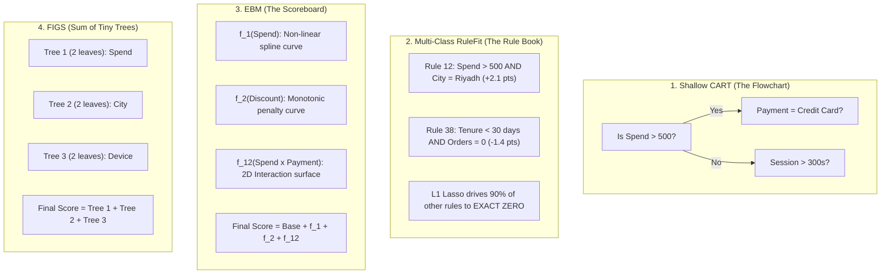

# Glass-Box Interpretable Models: The Complete Intuition & Architecture Guide
## Why Do They Exist, Why Did Accuracy Drop, and When Must You Use Them?

---

### 1. The Elephant in the Room: Why Did Accuracy Drop from ~99% to ~18%?

If you ran Notebooks 01, 02, and 03, you saw **Top-1 accuracies exceeding 95–99%**.  
Then you ran Notebook 04 (Glass-Box Models), and the accuracy dropped to **~18% Top-1 (and ~41% Top-3)**.

**Did the models fail? No! The experimental setup was completely different.** Here is why:

```
Notebooks 01–03 Setup (Unconstrained Black-Box Benchmark):
├── Features: 227 columns (including specific department view counts, cart-adds, and dwell times)
│   ├── dept_mobiles_views_past_30d = 14
│   ├── dept_gaming_cart_add_past_7d = 3
│   └── spend_ratio_mobiles_to_groceries = 4.2
└── Depth: 12 to 16 levels deep across 100 trees
Result: The model already knows the customer looked at Mobiles 14 times! Accuracy is ~99%.

Notebook 04 Setup (Regulated Glass-Box Scenario):
├── Features: ONLY 12 general demographic & behavioral attributes (NO department views)
│   ├── order_value_sar = 650.0 SAR
│   ├── governorate_ar = "الرياض"
│   ├── payment_method_ar = "بطاقة اائتمانية"
│   └── session_duration_seconds = 420.0
└── Depth: Stumps (depth 1–3) or pure additive 1D curves
Result: How can anyone know whether 650 SAR in Riyadh was spent on "Mobiles", "Large Appliances",
        or "Computers" without knowing what they clicked? You can only make a statistical guess!
```

#### The Math of Random Guessing:
* In a **2-class problem** (binary churn), random guessing is **50%**.
* In our **20-class problem**, random guessing is $\frac{1}{20} = \mathbf{5\%}$!
* Achieving **18% Top-1** and **41% Top-3** from just general order value and city alone is **nearly $4\times$ to $8\times$ better than random chance**!

---

### 2. The Accuracy vs. Interpretability Tradeoff (The Pareto Frontier)

In data science, there is a fundamental law: **You cannot get 100% human transparency and 100% non-linear interaction modeling for free.**

```
                       ACCURACY vs. INTERPRETABILITY SPECTRUM

   High ▲                                          [XGBoost / LightGBM / CatBoost]
        │                                          (Depth 12, 1,000 trees, Black-Box)
        │
A       │                                [EBM (Explainable Boosting Machine)]
C       │                                (Additive splines + top 10 interactions)
C       │
U       │                      [Multi-Class RuleFit]
R       │                      (Sparse L1 rules, SQL exportable)
A       │
C       │            [FIGS (imodels)]
Y       │            (Sum of 3–4 shallow trees)
        │
        │   [Shallow CART]
        │   (Depth 3 flowchart)
   Low  ▼────────────────────────────────────────────────────────────────────────►
            High                          INTERPRETABILITY                         Low
```

---

### 3. Why Do Glass-Box Models Exist? (The 4 Real-World Drivers)

If black-box models are more accurate on raw numbers, **why did Microsoft Research spend 10 years building EBM?** Why does every major bank and hospital use glass-box models?

#### Reason 1: The Famous "Asthma & Pneumonia" Catastrophe
In the 1990s, computer scientist **Rich Caruana** (who later invented EBM at Microsoft) trained a deep neural net and a tree ensemble to predict the mortality risk of pneumonia patients entering emergency rooms.

* **What the Black-Box Model Did**:
  The neural net learned that **patients who had asthma had a LOWER risk of dying from pneumonia** than non-asthmatics!
* **The Fatal Flaw**:
  Why did asthmatics survive more often? Because whenever an asthmatic got pneumonia, doctors knew they were in extreme danger and **immediately admitted them to the Intensive Care Unit (ICU)** with round-the-clock antibiotics!
* **The Danger**:
  If the hospital had deployed the black-box model to triage patients, the algorithm would have told doctors:  
  > *"This patient has asthma, so their risk is low. Send them home!"*  
  **Patients with asthma would have died.**
* **The Glass-Box Triumph**:
  A glass-box model showed doctors the exact 1D curve for Asthma: it was negative! The doctors spotted the error immediately, manually edited the curve to positive, and safely deployed the model.

---

#### Reason 2: Strict Legal Mandates (GDPR & Adverse Action)
In banking, lending, and healthcare, deploying a model whose decision you cannot explain is **illegal**:
1. **US Equal Credit Opportunity Act (ECOA)**: If you reject an applicant for a loan or BNPL (Tamara/Tabby), federal law requires you to provide **adverse action notices** (e.g., *"1. Debt-to-income too high, 2. Delinquencies in last 2 years"*).
   * You **cannot** say: *"XGBoost tree #412 split on column 83."*
2. **GDPR Article 22 (European Union)**: Citizens have a legal **"Right to an Explanation"** for automated profiling.

---

#### Reason 3: Zero-Dependency Deployment (Instant SQL & C++)
A standard XGBoost model requires a Python runtime, CUDA drivers, or ONNX libraries.  
A **RuleFit** or **EBM** model can be compiled into a **plain SQL query** that runs inside Snowflake, BigQuery, or PostgreSQL in **1 millisecond**:

```sql
-- Production SQL Query Exported Directly from RuleFit / EBM
SELECT customer_id,
    -- Base intercept
    0.25 
    -- 1D Shape: Order Value Contribution
    + CASE 
        WHEN order_value_sar > 800 THEN +2.40
        WHEN order_value_sar > 400 THEN +0.85
        ELSE -1.10
      END
    -- Sparse Rule: Installments in Riyadh
    + CASE 
        WHEN payment_method = 'تمارا' AND governorate = 'الرياض' THEN +1.75 
        ELSE 0.0
      END AS logit_mobiles_department
FROM live_transactions;
```

---

### 4. Visual Walkthrough of the 4 Glass-Box Architectures



---

### 5. Architectural Comparison Matrix

| Model | How It Computes a Prediction | Accuracy Potential | Human Readability | Can You Export to SQL? | Best Use Case |
| :--- | :--- | :--- | :--- | :--- | :--- |
| **Shallow CART** | Follows a single visual tree flowchart | Low | **Instant** (Anyone can read it) | Yes (Nested `IF/ELSE`) | Executive presentations, initial baselines |
| **Multi-Class RuleFit** | Adds points from 10–20 plain English rules | Moderate | **Very High** (Sparse rule book) | **Yes (Simple `CASE WHEN`)** | Audit-regulated risk scoring, credit approval |
| **EBM ($\text{GA}^2\text{M}$)** | Look up value on 1D curves and add them up | **High (Near GBDT)** | **High** (Visual graph curves) | Yes (Array lookup table) | Healthcare, fair-lending, regulated pricing |
| **FIGS** | Adds outputs from 3–5 tiny tree stumps | Moderate / High | **High** (Small tree bundle) | Yes | Rapid prototyping, fast rule discovery |
| **Unconstrained GBDT** | Averages 1,000 deep trees (depth 8–16) | **Highest (SOTA)** | **Zero (Black-Box)** | No (Requires C++/ONNX runtime) | Search ranking, ad-click prediction, computer vision |

---

### 6. Summary Takeaway

* **Notebooks 01–03** taught you how to build the **fastest, most accurate black-box engines** on earth using GPUs and 200+ features.
* **Notebook 04** taught you how to build **legally compliant, transparent, auditable models** that protect companies from lawsuits, medical mistakes, and regulatory fines.
